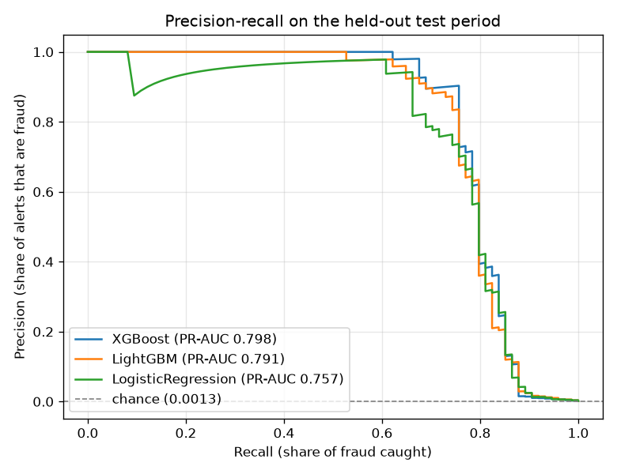
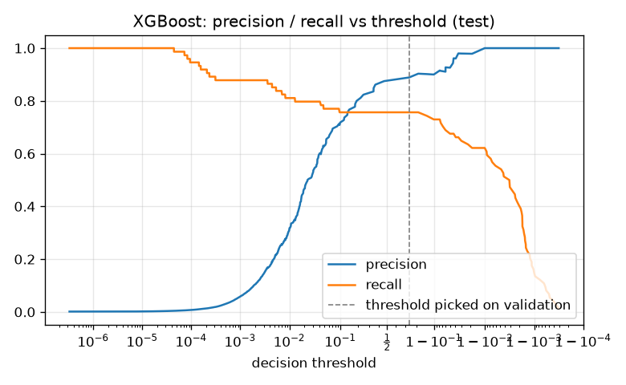

# Credit-card fraud detection with XGBoost and LightGBM

Boosted-tree fraud models on the [ULB credit-card fraud dataset](https://www.kaggle.com/datasets/mlg-ulb/creditcardfraud):
284,807 European card transactions over two days, of which 492 (0.17%) are fraud.
I evaluate them the way a fraud team would. The test set is a **later time period** than the training data,
the decision threshold is chosen on a separate validation period, and the headline metrics are
**precision, recall and PR-AUC**. Accuracy is not one of them.

## Results (held-out test period: 56,746 transactions, 74 frauds)

| Model | Imbalance handling | PR-AUC | Precision | Recall | F1 | Fraud **amount** caught |
|---|---|---|---|---|---|---|
| **XGBoost** | sqrt class weight | **0.798 ± 0.005** | **0.90** | **0.75** | **0.82** | **66%** |
| LightGBM | undersample legit to 1:20 | 0.791 ± 0.002 | 0.88 | 0.72 | 0.79 | 60% |
| Logistic regression (baseline) | balanced class weight | 0.757 | 0.94 | 0.66 | 0.78 | 57% |
| "Everything is legit" | n/a | 0.001 | 0 | 0 | 0 | 0% |

Mean ± std over 5 seeds. The 95% bootstrap CI on XGBoost's test PR-AUC is **0.71 to 0.88**, because
74 frauds is a small sample.

In plain terms, XGBoost raises about **62 alerts in 56,746 transactions**. About 56 of them are real fraud and
6 are false alarms. It catches 56 of the 74 frauds.

**Why accuracy is ignored here:** predicting "legit" for every transaction scores **99.87% accuracy** and catches
zero fraud. Every model in the table rounds to 99.9% accuracy, so the number tells you nothing.



## Method

1. **Cleaning.** Drop 1,081 exact duplicate rows and sort by time. There are no missing values.
2. **Chronological split, 60 / 20 / 20.** Train on the earliest 60%, tune on the next 20%, test on the latest 20%.
   - A random stratified split gives XGBoost a test PR-AUC of **0.877** instead of 0.798.
   - The random split mixes transactions from the same fraud bursts across train and test.
   - It also hides the drift a deployed model would face. The fraud rate is 0.20% in train, 0.10% in val and 0.13% in test.
3. **Feature engineering** (`src/features.py`). Every window looks strictly backwards in time.
   - Time of day as sin/cos, plus a night flag.
   - Log amount, and flags for zero, micro (≤ 1) and round amounts. Micro charges can be card testing.
   - Stream activity: transaction counts and mean amounts in the previous 1 min, 10 min and 1 h, how this
     amount compares with the 1-hour mean, and same-second bursts.
4. **Imbalance handling.** Four strategies are compared for each model:
   - none
   - full class weight (`scale_pos_weight = neg/pos ≈ 500`)
   - square-root class weight (≈ 22)
   - random undersampling of legit transactions to 1:20
5. **Model selection.** A grid of 2 models × 2 feature sets × 4 strategies.
   - Early stopping on validation PR-AUC. The best configuration per model is picked on validation PR-AUC.
   - The full grid is in [`results/grid_validation.csv`](results/grid_validation.csv).
6. **Threshold.** Chosen on validation to maximise F1, then applied unchanged to the test set.

## What I learned (the honest part)

- **Imbalance strategy matters less than people expect.** All four strategies land within about 0.02 PR-AUC on validation.
  - Full `neg/pos` weighting (≈ 500×) was the worst option for XGBoost and for LightGBM on raw features.
    It treats each fraud as 500 rows, so the trees overfit the few training frauds.
  - Softer weighting or mild undersampling worked best.
  - Undersampling had a second benefit for LightGBM: it trained on 7k rows instead of 170k.
- **The engineered features did not beat the raw features.** On validation, raw+engineered scored within ±0.01 PR-AUC
  of raw-only, which is inside the noise for 57 validation frauds. So the final models use the raw features.
  - The likely reason is that the V1 to V28 components are a PCA of the bank's own (hidden) features, and they probably
    already encode customer behaviour.
  - The dataset has **no card or customer ID**, so the most useful fraud features can't be built: per-card velocity,
    distance from the card's usual amount, new merchant for this card.
  - On data with entity IDs (for example IEEE-CIS), I would expect those to be the main source of gains.
- **Boosted trees beat the linear baseline mainly at high recall.** All three models have similar precision at low
  recall. XGBoost keeps precision at 0.9 or higher out to 75% recall, while logistic regression falls below 0.9
  at 66%.
- **The threshold is a business decision, not a model property.** `figures/threshold_tradeoff.png` shows the trade-off:
  - pushing XGBoost from 75% to 80% recall drops precision from 0.90 to 0.40, so the last few frauds cost
    about 6 false alarms each
  - with a fixed analyst budget, you would pick the threshold from alerts per day instead of F1



## Run it

```bash
python -m venv .venv && .venv/Scripts/activate      # or source .venv/bin/activate
pip install -r requirements.txt
mkdir data && curl -L -o data/creditcard.csv https://storage.googleapis.com/download.tensorflow.org/data/creditcard.csv
python train.py      # about 4-5 min on a laptop CPU; writes results/ and figures/
```

The data file is a public mirror of the Kaggle dataset, the same one TensorFlow's imbalanced-data tutorial uses.

## Files

```
src/features.py              cleaning, feature engineering, chronological split
train.py                     grid search, multi-seed evaluation, baselines, plots
results/metrics.json         every number in this README
results/grid_validation.csv  all 16 validation runs
figures/                     PR curves, threshold trade-off, feature importance
```
